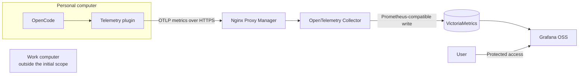

# OpenCode Telemetry

OpenCode Telemetry is a self-hosted way to understand and visualize OpenCode usage in one place. It brings together metrics such as token consumption, models, providers, response duration, and sessions, and presents them in Grafana dashboards.

The goal is to provide an alternative to external analytics services that remains under the user's control. Metrics are received and stored on a Ugreen NAS using open-source components.

## Why This Project Exists

AI usage can be spread across multiple providers and models. Without a shared record, it is difficult to answer everyday questions: which models are used most, how many tokens are consumed, and how usage changes over time.

This project provides that record for OpenCode. Its plugin observes usage events already produced by OpenCode and sends standardized metrics to the NAS. Grafana makes those metrics easy to explore and turn into dashboards.

## Data Flow

Metric ingestion and dashboard access are separate flows. The plugin sends metrics to the NAS, while Grafana queries the stored data. The databases do not need to be exposed directly to the internet.

## What It Tracks

- Input, output, reasoning, and cache token volumes.
- Usage by provider and model.
- Completed assistant messages and sessions.
- Response duration and session errors.
- Cost as reported by OpenCode, without assuming or converting a currency.

Metrics are aggregated to show trends and comparisons. The project is not intended to retain conversations or inspect session content.

## Privacy and Scope

The plugin does not send prompts, responses, project names, file paths, or session identifiers. Installations are distinguished using stable labels, such as the user and source configured for each device.

The initial setup is for the personal computer only. It does not install anything on or change the configuration of the work computer. It also does not monitor general computer activity such as CPU, memory, or other applications; it focuses on OpenCode usage.

Model and provider names, together with usage volumes, can reveal sensitive information. Ingestion therefore requires a dedicated credential and HTTPS. Grafana should remain behind protected access and should not be shared publicly without additional controls.

## Components

- **OpenCode plugin:** turns OpenCode usage events into metrics.
- **OpenTelemetry Collector:** receives, validates, and routes metrics.
- **VictoriaMetrics:** stores time series with configurable retention.
- **Grafana OSS:** provides queries, comparisons, and visual dashboards.
- **Nginx Proxy Manager:** provides HTTPS access to the metrics receiver and, optionally, a separate route to Grafana.

The metrics pipeline uses OpenTelemetry and Prometheus-compatible formats to keep the plugin independent from the storage backend. The initial deployment is a single node, which is suitable for starting on a home NAS but does not provide high availability. NAS resilience depends on backups, not on container redundancy.

The telemetry components and reverse proxy are open source. Cloudflare may remain in use as an existing DNS or proxy provider, but it is not a dependency for metric storage or analysis.

## Intended Use

1. Deploy the metrics services on the NAS and choose a data-retention period.
2. Configure a dedicated HTTPS hostname for metric ingestion, protected by a private credential.
3. Install and configure the plugin in OpenCode on the personal computer.
4. Use OpenCode as usual and explore the data in Grafana to create or adapt dashboards.
5. Include the configuration and persistent data in the NAS backup plan.

## Deployment

For installation on a NAS or server using Docker Compose, follow [DEPLOY.md](DEPLOY.md). The base Compose deployment does not require Nginx Proxy Manager; an optional overlay is provided for existing NPM installations.
